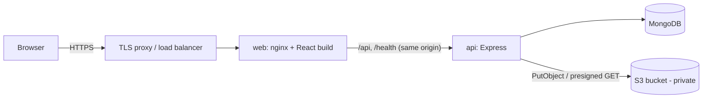

# Folderly

**Secure, role-based file uploads with built-in reporting.**
Users sign in, upload files to a private S3 bucket organised as `ROLE/USERNAME/DATE/`, and see their own activity.
Admins create users and see organisation-wide dashboards.

| | |
|---|---|
| **API** | Node.js 18+/20 · Express 4 · MongoDB (Mongoose 8) · AWS S3 · JWT + rotating refresh tokens |
| **Web** | React 18 · Vite 5 · React Router 6 · Recharts · Lucide icons (AdminLTE-style UI, light/dark) |
| **Security** | RBAC · bcrypt · account lockout · refresh-token reuse detection · Zod validation · Helmet · rate limits · private encrypted S3 |

---

## Contents
1. [Features](#1-features) · 2. [Architecture](#2-architecture) · 3. [Repository layout](#3-repository-layout) · 4. [Quick start (development)](#4-quick-start-development) · 5. [Configuration](#5-configuration) · 6. [AWS S3 setup](#6-aws-s3-setup) · 7. [MongoDB setup](#7-mongodb-setup) · 8. [Deploying to production](#8-deploying-to-production) · 9. [Security model](#9-security-model) · 10. [Roles & permissions](#10-roles--permissions) · 11. [API reference](#11-api-reference) · 12. [Operations](#12-operations) · 13. [Production checklist](#13-production-checklist) · 14. [Troubleshooting](#14-troubleshooting) · 15. [Known limitations](#15-known-limitations)

---

## 1. Features
- **Authentication**: username/email + password, 15-minute access JWT, httpOnly rotating refresh cookie, logout / logout-all, change password. No public sign-up – admins create accounts.
- **RBAC**: permission-based (`authorize(PERMISSIONS.X)`); role is re-read from the database on every request so role changes and deactivation apply immediately.
- **File uploads**: multipart upload to S3 at `ROLE/USERNAME/YYYY-MM-DD/<uuid>-<filename>`; content-type verified by magic bytes; encrypted at rest; presigned, short-lived downloads.
- **Reports**: each user sees only their own stats; admins get an organisation dashboard, a per-user table and per-user drill-down.
- **Dashboard UI**: icon KPI boxes, animated charts, sidebar with search, toasts, light/dark/system theme, fully responsive.

## 2. Architecture

- The browser talks to **one origin**. nginx serves the SPA and proxies `/api` and `/health` to the API, so the `SameSite=Strict` refresh cookie works and **no CORS is needed**.
- The API is **stateless** (sessions live in MongoDB), so it can run as several replicas.
- Files never touch the disk: they are streamed from memory to S3. Downloads use presigned URLs, so file bytes do not pass through the API.

**S3 key layout** (inside the bucket):
```
marketing/riya/2026-11-19/3f2c…-report.pdf
└─role──┘ └user┘ └─date──┘ └─uuid-sanitised filename
```
The date uses `APP_TIMEZONE` (default `Asia/Kolkata`). Role and username are validated slugs (`[a-z0-9_-]`), so path traversal is impossible.

## 3. Repository layout
```
folderly/
├─ api/                      # Express API
│  ├─ src/
│  │  ├─ config/             # env (Zod-validated), db, logger, s3
│  │  ├─ constants/          # roles + permissions, allowed upload types
│  │  ├─ middlewares/        # authenticate, authorize, validate, rate limiters, upload, errors
│  │  ├─ modules/            # auth · users · uploads · reports (routes/controller/service/validation/model)
│  │  ├─ utils/ · routes/ · scripts/seedAdmin.js · app.js · server.js
│  ├─ docs/                  # Postman collection + cURL examples
│  └─ Dockerfile
├─ web/                      # React dashboard
│  ├─ src/ (pages, components, api client, auth, theme, toast)
│  ├─ nginx.conf · security-headers.conf · Dockerfile
├─ docker-compose.yml        # MongoDB + API + web
└─ README.md
```

## 4. Quick start (development)
**Prerequisites:** Node.js 18+ (20 recommended), MongoDB 6+ (local or Atlas), an S3 bucket + credentials (see [§6](#6-aws-s3-setup)).

```bash
# 1) API
cd api
cp .env.example .env                 # fill MONGO_URI, JWT_ACCESS_SECRET, AWS_*, ADMIN_*
npm install
npm run seed:admin                   # creates the first admin from ADMIN_* variables
npm run dev                          # http://localhost:5000

# 2) Web (new terminal)
cd web
npm install
npm run dev                          # http://localhost:3000  (Vite proxies /api and /health to :5000)
```
Sign in at http://localhost:3000 with the admin you seeded, create a user under **Users**, then sign in as that user and upload a file.

Generate a strong JWT secret:
```bash
node -e "console.log(require('crypto').randomBytes(64).toString('hex'))"
```

## 5. Configuration

### API (`api/.env`) – validated at startup; the process exits with a clear error if invalid
| Variable | Required | Default | Description |
|---|:--:|---|---|
| `NODE_ENV` | | `development` | Use `production` in prod (enables `Secure` cookies). |
| `PORT` | | `5000` | HTTP port. |
| `TRUST_PROXY` | | `0` | **Number of reverse proxies in front of the API** (nginx only → `1`; load balancer + nginx → `2`). Needed for correct client IPs / rate limiting. |
| `APP_TIMEZONE` | | `Asia/Kolkata` | Timezone used for the `DATE` folder and report ranges (IANA name). |
| `MONGO_URI` | ✔ | – | MongoDB connection string. |
| `JWT_ACCESS_SECRET` | ✔ | – | ≥ 32 chars (use 64 random bytes). Rotating it signs everyone out. |
| `JWT_ACCESS_EXPIRES` | | `15m` | Access-token lifetime. |
| `JWT_ISSUER` / `JWT_AUDIENCE` | | `folderly` / `folderly-clients` | Verified on every token. |
| `REFRESH_TOKEN_TTL_DAYS` | | `7` | Refresh-cookie / session lifetime. |
| `BCRYPT_ROUNDS` | | `12` | Min 10. |
| `MAX_LOGIN_ATTEMPTS` / `LOCK_MINUTES` | | `5` / `15` | Account lockout policy. |
| `CORS_ORIGINS` | | *(empty)* | Comma-separated allowed origins. Leave empty when web and API share an origin. |
| `AWS_REGION` | ✔ | – | e.g. `ap-south-1`. |
| `AWS_S3_BUCKET` | ✔ | – | Private bucket name. |
| `AWS_ACCESS_KEY_ID` / `AWS_SECRET_ACCESS_KEY` | | – | **Local dev only.** In production use an IAM role. |
| `MAX_FILE_SIZE_MB` / `MAX_FILES_PER_REQUEST` | | `10` / `5` | Keep nginx `client_max_body_size` ≥ product of the two. |
| `SIGNED_URL_TTL_SECONDS` | | `300` | Lifetime of download links. |
| `LOG_LEVEL` | | `info` | pino level. |
| `ADMIN_NAME` `ADMIN_USERNAME` `ADMIN_EMAIL` `ADMIN_PASSWORD` | seed only | – | Used by `npm run seed:admin`; remove after seeding. |

### Web (`web/.env`, build-time)
| Variable | Default | Description |
|---|---|---|
| `VITE_API_URL` | *(empty)* | Leave empty for same-origin deployment (recommended). Set only if the API is on another origin; then also set the API's `CORS_ORIGINS`, and keep both on the **same site** (e.g. `app.example.com` + `api.example.com`) so the Strict cookie is sent. |

### Docker Compose (`./.env`)
`MONGO_USER`, `MONGO_PASSWORD` – credentials for the bundled MongoDB container.

## 6. AWS S3 setup
1. **Create a bucket** in your region. Enable **Block all public access**, **default encryption (SSE-S3)** and **versioning**. Add lifecycle rules (e.g. expire old versions after 30–90 days).
2. **No bucket CORS is required**: uploads go through the API and downloads are opened as top-level navigations to presigned URLs.
3. **IAM**: attach this minimal policy to the role/user the API runs as:
```json
{
  "Version": "2012-10-17",
  "Statement": [{
    "Effect": "Allow",
    "Action": ["s3:PutObject", "s3:GetObject", "s3:DeleteObject"],
    "Resource": "arn:aws:s3:::YOUR_BUCKET/*"
  }]
}
```
4. **Credentials**: on AWS (ECS/EKS/EC2/Lambda) attach the policy to the **task/instance role** and leave `AWS_ACCESS_KEY_ID`/`AWS_SECRET_ACCESS_KEY` empty. Elsewhere, create a dedicated IAM user with only this policy and rotate its keys regularly.
5. Consider **GuardDuty Malware Protection for S3** (or ClamAV) if users upload untrusted documents.

## 7. MongoDB setup
- Use **MongoDB Atlas** or a replica set with authentication and TLS; create a **least-privilege user** limited to the `folderly` database. Restrict network access (VPC peering / IP allow-list).
- Collections: `users`, `sessions` (TTL index removes expired sessions automatically), `uploads`.
- Indexes are created automatically by Mongoose on first start. For very large collections create them during a maintenance window (or disable `autoIndex` and run `syncIndexes()` from a deploy script).
- **Back up** regularly (Atlas continuous backup or scheduled `mongodump`) and test restores. Backups of S3 are covered by versioning; MongoDB holds the metadata that maps files to users.

## 8. Deploying to production

### Option A – Docker Compose (single host)
```bash
cp .env.example .env                 # set MONGO_USER / MONGO_PASSWORD
cp api/.env.example api/.env         # set JWT_ACCESS_SECRET, AWS_*, CORS_ORIGINS, ADMIN_* (MONGO_URI is injected by compose)
docker compose up -d --build
docker compose exec api node src/scripts/seedAdmin.js     # create the first admin once
```
`web` listens on port 80 (HTTP). **Put TLS in front** (Caddy, Traefik, an AWS ALB or Cloudflare) – the refresh cookie is marked `Secure` in production, so the app needs HTTPS to keep users signed in. When TLS ends at a proxy in front of nginx, set `TRUST_PROXY=2` and uncomment the HSTS line in `web/security-headers.conf`.

### Option B – VM with PM2 + nginx
```bash
cd api && npm ci --omit=dev && NODE_ENV=production pm2 start src/server.js --name folderly-api -i max
cd ../web && npm ci && npm run build            # copy dist/ to /var/www/folderly
```
Use `web/nginx.conf` as the site config (change `proxy_pass` to `http://127.0.0.1:5000`, set `root` to your dist folder, add your TLS block via Certbot). Set `TRUST_PROXY=1`.

### Option C – Container platform (ECS/Kubernetes/Cloud Run)
Build `api/Dockerfile` and `web/Dockerfile`, run the API with an IAM role that has the S3 policy, route `/api/*` and `/health` to the API and everything else to `web` on the **same domain** (path-based routing on an ALB/Ingress), and inject secrets from Secrets Manager / Kubernetes secrets. The API exposes `GET /health` for liveness/readiness probes.

> The Dockerfiles, nginx config and compose file are provided as a ready starting point – review them (resource limits, image pinning, logging driver) against your platform's standards before go-live.

## 9. Security model
**Authentication**
- Passwords: bcrypt (cost 12); policy 12–72 chars with upper, lower, number and special character; constant-time login path (no user enumeration).
- Lockout: `MAX_LOGIN_ATTEMPTS` failures → locked for `LOCK_MINUTES` (HTTP 423).
- Access token: JWT HS256 (algorithm pinned, issuer/audience verified), 15 min, **bound to a server-side session** (`sid`), so logout, logout-all, password change/reset, role change and deactivation take effect immediately.
- Refresh token: opaque 384-bit random value; only its SHA-256 hash is stored; delivered in an **httpOnly, `SameSite=Strict`, `Secure` (prod), path `/api/v1/auth`** cookie; **rotated on every use**; reuse of an old token revokes the whole session family.
- The web app keeps the access token **in memory only** (never `localStorage`) and restores the session from the refresh cookie.

**Authorization** – default deny; every route declares required permissions; regular users' reports and file lists are always scoped to `req.user` (ids are never taken from the client); other users' files return `404` rather than `403`.

**Input & transport** – Zod `.strict()` schemas (blocks unknown fields / mass assignment), `express-mongo-sanitize`, `hpp`, 10 KB JSON body limit, Helmet, CORS allow-list, nginx CSP and security headers.

**Uploads** – allow-listed types (`pdf png jpg/jpeg csv txt docx xlsx`), extension + declared type + **magic-byte** verification, size/count limits, sanitised filenames, SSE-S3 encryption, batch is all-or-nothing (S3 objects cleaned up on failure), private bucket + presigned URLs.

**Rate limits (per IP)**
| Scope | Limit |
|---|---|
| All requests | 300 / 15 min |
| `POST /auth/login` | 10 / 15 min |
| `POST /auth/refresh` | 60 / 15 min |
| `POST /uploads` | 100 / hour |

**Logging** – structured JSON (pino) with `Authorization`, cookies and password fields redacted; errors never leak stack traces to clients.

## 10. Roles & permissions
Defined in one place: `api/src/constants/roles.js`.

| Permission | admin | other roles (`marketing`, `sales`, `hr`, `finance`, `support`) |
|---|:--:|:--:|
| `user:create / read / update / delete` | ✔ | – |
| `upload:create` | ✔ | ✔ |
| `upload:read:own` | ✔ | ✔ |
| `upload:read:all` | ✔ | – |
| `report:read:own` | ✔ | ✔ |
| `report:read:all` | ✔ | – |

**Add or rename a role:** edit `ROLES` in `api/src/constants/roles.js` (lowercase `[a-z0-9_-]` – it becomes the S3 folder name) and update the `ROLES` arrays in `web/src/pages/Users.jsx` and `web/src/pages/Reports.jsx`. Existing users/files keep their previous role name.

## 11. API reference
Base path `/api/v1`. All responses: `{ "success": true, "data": …, "meta"?: … }` or `{ "success": false, "message": "…", "details"?: […] }`. Authenticated routes need `Authorization: Bearer <accessToken>`.

| Method | Path | Access | Purpose |
|---|---|---|---|
| POST | `/auth/login` | public | `{identifier, password}` → access token + refresh cookie |
| POST | `/auth/refresh` | cookie | Rotate refresh token, new access token |
| POST | `/auth/logout` | cookie/Bearer | End this session |
| POST | `/auth/logout-all` | any | End all sessions |
| POST | `/auth/change-password` | any | Change own password (signs out everywhere) |
| GET | `/auth/me` | any | Current user |
| POST / GET | `/users` | admin | Create / list (`page, limit, role, isActive, search`) |
| GET / PATCH / DELETE | `/users/:id` | admin | Read / update `name, role, isActive` / deactivate |
| POST | `/users/:id/reset-password` | admin | Set a new password |
| POST | `/uploads` | any | multipart, field **`files`** (≤ 5 × 10 MB) |
| GET | `/uploads/me` | any | Own files (`from, to, page, limit`) |
| GET | `/uploads` | admin | All files (`userId, role, from, to`) |
| GET | `/uploads/:id/download` | owner / admin | 5-minute presigned URL |
| GET | `/reports/me` | any | Own stats (`from, to` = `YYYY-MM-DD`; default last 30 days, max 366) |
| GET | `/reports/dashboard` | admin | Organisation overview |
| GET | `/reports/users` | admin | Per-user table (includes users with 0 uploads) |
| GET | `/reports/users/:id` | admin | Single-user report |
| GET | `/health` *(outside `/api/v1`)* | public | Liveness probe |

Status codes: `400` validation · `401` unauthenticated/expired · `403` forbidden · `404` not found · `409` duplicate · `413` too large · `415` bad file type · `423` locked · `429` rate limited · `500` unexpected.
Ready-made requests: `api/docs/folderly-api.postman_collection.json` (auto-saves tokens/ids, includes RBAC checks) and `api/docs/CURL_EXAMPLES.md`.

## 12. Operations
- **Health & probes**: `GET /health` (API), `GET /healthz` (nginx). The UI footer shows live API status.
- **Logs**: JSON on stdout – ship with your platform (CloudWatch, Loki, ELK). Each request has a request id. Alert on 5xx rate, repeated 401/423 spikes and `Failed to clean up S3 object` messages.
- **Graceful shutdown**: SIGTERM/SIGINT stop accepting connections, close MongoDB, exit (10 s hard timeout).
- **Scaling**: run multiple API replicas; size memory for `MAX_FILE_SIZE_MB × MAX_FILES_PER_REQUEST × concurrent uploads` because uploads are buffered in memory.
- **Secret rotation**: changing `JWT_ACCESS_SECRET` invalidates all access tokens (users re-login). Rotate AWS keys without downtime by adding the new key, redeploying, then deleting the old one.
- **Deactivating a user** immediately ends their sessions; files and history are kept.
- **Upgrades**: `npm audit` + dependency updates monthly; rebuild images from a pinned base.

## 13. Production checklist
- [ ] HTTPS everywhere; `NODE_ENV=production`; HSTS enabled once TLS is verified
- [ ] `JWT_ACCESS_SECRET` is 64 random bytes, stored in a secrets manager (not in Git)
- [ ] `TRUST_PROXY` equals the number of proxies in front of the API
- [ ] Web and API are served from the **same site**; `VITE_API_URL` empty (or CORS configured deliberately)
- [ ] S3: block public access, encryption, versioning, lifecycle rules, IAM **role** with the minimal policy
- [ ] MongoDB: auth + TLS + network restrictions + backups tested
- [ ] First admin seeded, `ADMIN_*` variables removed, admin password changed
- [ ] nginx `client_max_body_size` ≥ `MAX_FILES_PER_REQUEST × MAX_FILE_SIZE_MB`
- [ ] Logs shipped; alerts on 5xx, auth failures and health checks
- [ ] Redis-backed rate limiting if running more than one API instance
- [ ] Malware scanning for uploads if files come from untrusted users
- [ ] Dependency audit (`npm audit`) and image scan in CI

## 14. Troubleshooting
| Symptom | Likely cause / fix |
|---|---|
| `401 Invalid or expired token` with log reason `invalid signature` | Token was signed with a different `JWT_ACCESS_SECRET` (changed `.env`, second server instance, stale token in Postman). Log in again. |
| `jwt audience/issuer invalid` | `JWT_AUDIENCE`/`JWT_ISSUER` changed after the token was issued. Log in again. |
| `401 Session ended` right after logout | Expected – logout revokes the session behind the access token. |
| Signed out on every page reload in production | Site is on HTTP (the `Secure` cookie is dropped) or web and API are on different sites (`SameSite=Strict`). Use HTTPS and one site. |
| Every user shares one rate limit / wrong IPs in logs | `TRUST_PROXY` is wrong. Set it to the number of proxies. |
| `413` on upload | Larger than `MAX_FILE_SIZE_MB`, or nginx `client_max_body_size` too small. |
| `415 File content does not match its type` | Extension or declared type does not match the real file content. |
| `423 Account temporarily locked` | Too many failed logins; wait `LOCK_MINUTES` or an admin resets the password. |
| S3 `AccessDenied` | IAM policy missing `s3:PutObject/GetObject/DeleteObject` on `bucket/*`, wrong region, or wrong bucket name. |
| Admin pages missing for a user | UI hides them for non-admins; the API also returns `403`. |
| Concurrent tabs suddenly logged out | Two tabs refreshed at the same instant, tripping reuse detection – sign in again. |

## 15. Known limitations
- Rate-limit counters are in memory (per instance) – use a shared store (Redis) for multi-instance deployments.
- Uploads are buffered in memory; for very large files switch to presigned direct-to-S3 multipart uploads.
- No email flows (password reset by email, invitations) and no MFA yet.
- No automated test suite is included – add integration tests (Supertest + a test MongoDB) before extending the API.
- The bundled Docker/nginx files have not been load- or penetration-tested; treat them as a starting point.

## License
Add your license here. © Folderly.
